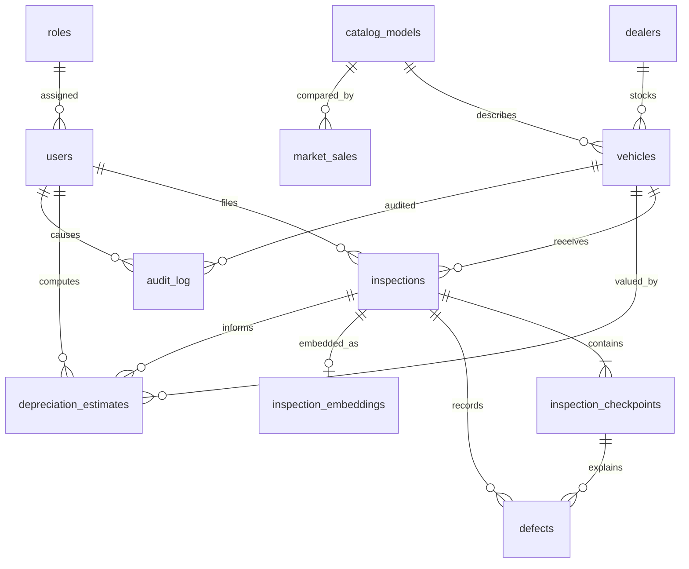
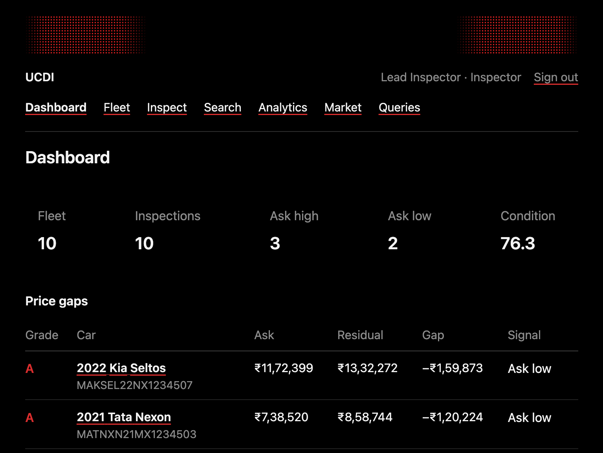
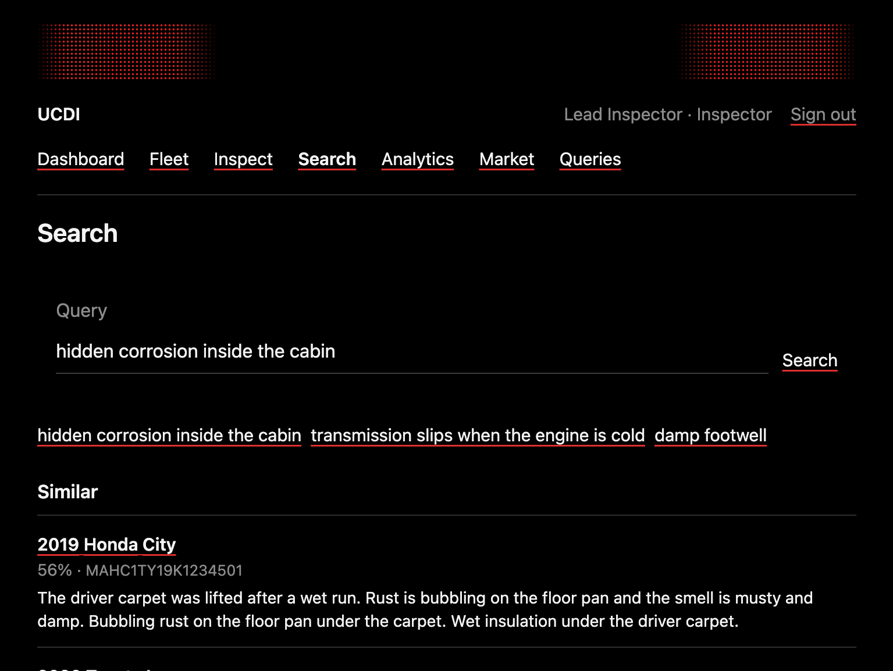

# UCDI — Used-Car Inspection, Condition & Depreciation Intelligence

## Problem statement

A used-car desk decides what to pay, what to ask, and what to walk away from. The decision depends on a multi-point inspection, not on the model year alone. Spreadsheets lose the link between a failed checkpoint, the repair it implies, and the asking price. Free-text notes are hard to search when the next buyer describes the same fault in different words.

UCDI keeps the structured condition file, computes a residual from that file, and retrieves similar narratives.

## Objectives

- Record vehicles, inspections, checkpoints, and defects with enforceable integrity rules.
- Derive a letter grade and a residual value inside PostgreSQL, not in a page script.
- Keep variable inspection dossiers in MongoDB.
- Retrieve similar dossiers by cosine similarity over embeddings.
- Give admin, inspector, and buyer different access through a Next.js desk.

## Scope

In scope: fleet intake, inspection filing, residual snapshots, recorded market sales, semantic and full-text search, role-based access, and an audit trail of vehicle changes.

Out of scope: live market feeds, payment, document imaging binaries, and a learned pricing model. Recorded sales are a comparator. They are not inputs to the residual formula. Attachment rows store labels only, not image files.

The sample yard uses illustrative ex-showroom anchors and fictional dealers (Estuary Motors, Deccan Wheels, Harbour Auto). Those figures are for the lab, not a claim about a manufacturer’s price list.

## Functional requirements

1. An admin manages accounts and can do everything an inspector can do.
2. An inspector adds cars, files inspections, records sales, and changes an asking price.
3. A buyer can read the fleet, residuals, dossiers, search, and analytics, and cannot change them.
4. Filing an inspection stores checkpoints and defects, scores the car, updates the vehicle grade, stores a residual snapshot, writes a dossier, and embeds the narrative.
5. The asking price is compared with the latest residual. More than 8% above is “ask high”. More than 8% below is “ask low”.
6. Search shows three results for one question: pgvector, PostgreSQL full-text, and a MongoDB text index.
7. Completed inspections are voided, not deleted. Voiding restores the previous completed grade.
8. Vehicle changes to price, grade, odometer, and status are audited.

## Team responsibilities

Replace the labels with the two approved members and commit from each account.

| Track | Work |
| --- | --- |
| Member A — database | `db/schema.sql`, residual function, triggers, views, seed, `scripts/verify.mjs` |
| Member B — application | Next.js desk, route handlers, MongoDB dossiers, search and analytics pages, authentication |

## ER diagram



`market_sales` references `catalog_models`, not `vehicles`, because a recorded sale is someone else’s car. The MongoDB collection `inspection_dossiers` is linked by `sqlInspectionId` and is not part of the relational diagram.

## Relational schema

| Table | Primary key | Important foreign keys |
| --- | --- | --- |
| roles | role_id | |
| users | user_id | role_id → roles |
| dealers | dealer_id | |
| catalog_models | model_id | unique (make, model) |
| vehicles | vehicle_id | model_id, dealer_id; unique vin |
| inspections | inspection_id | vehicle_id, inspector_id |
| inspection_checkpoints | checkpoint_id | inspection_id; unique (inspection_id, item_name) |
| defects | defect_id | inspection_id, checkpoint_id |
| depreciation_estimates | estimate_id | vehicle_id, inspection_id, computed_by |
| inspection_embeddings | embedding_id | inspection_id unique |
| market_sales | sale_id | model_id |
| audit_log | audit_id | changed_by → users |

`db/schema.sql` rebuilds this from scratch. It uses `CREATE`, then `ALTER TABLE` to add the model-year check, then `CREATE` / `ALTER` / `DROP` on a scratch table `load_staging` so those statements are executed rather than only described.

## Why these databases

| Store | What it holds | Why |
| --- | --- | --- |
| PostgreSQL | Users, fleet, checkpoints, defects, residuals, audit, full-text on the short summary | The desk needs transactions, foreign keys, and checks. A residual and a grade must not drift between rows. |
| MongoDB | Narrative, weather, lighting, OBD codes, attachment labels, remarks | A dossier does not have a fixed shape. One car has two OBD codes and two photo labels; another has none. |
| pgvector inside PostgreSQL | 64-dimension embedding of the narrative plus defect text | Similarity has to sit next to grade and price filters. A separate vector product would split that lookup. |

The narrative is not copied into the full-text column on purpose. Full-text sees the summary. The embedding sees the narrative. That is what makes the search page show different hits.

## Data dictionary

### roles

| Column | Type | Rules | Meaning |
| --- | --- | --- | --- |
| role_id | integer identity | PK | |
| role_name | text | unique, in admin / inspector / buyer | Desk role |

### users

| Column | Type | Rules | Meaning |
| --- | --- | --- | --- |
| user_id | integer identity | PK | |
| full_name | text | 2–80 characters | Display name |
| email | text | unique, email shape, stored lowercase | Login |
| password_hash | text | must match a bcrypt prefix `$2a$`, `$2b$`, or `$2y$` | Never the password |
| role_id | integer | FK | |
| is_active | boolean | default true | Inactive users cannot sign in |
| created_at | timestamptz | default now | |

### dealers

| Column | Type | Rules | Meaning |
| --- | --- | --- | --- |
| dealer_id | integer identity | PK | |
| name | text | 2–80 | Yard name |
| city | text | 2–60 | |
| license_no | text | unique, 4–30 | |

### catalog_models

| Column | Type | Rules | Meaning |
| --- | --- | --- | --- |
| model_id | integer identity | PK | |
| make, model | text | unique together | |
| segment | text | hatch / sedan / suv / muv | |

### vehicles

| Column | Type | Rules | Meaning |
| --- | --- | --- | --- |
| vehicle_id | integer identity | PK | |
| vin | char(17) | unique, charset without I, O, Q | |
| model_id, dealer_id | integer | FK | |
| variant | text | 1–40 | |
| model_year | integer | 1995–2030, added with ALTER | |
| fuel_type | text | petrol, diesel, cng, electric, hybrid | |
| transmission | text | manual, automatic, amt, cvt, dct | |
| odometer_km | integer | 0–1,000,000, cannot decrease | Trigger |
| color, registration_state | text | length checks | |
| owner_count | integer | 1–12 | |
| accident_count | integer | 0–20 | |
| list_price, original_msrp | numeric(12,2) | > 0 | Ask and ex-showroom anchor |
| condition_score | numeric(5,1) | 0–100 or null | Copied from the latest completed inspection |
| current_grade | text | A–F or null | From `fn_grade_from_score` |
| status | text | available, under_inspection, sold, withdrawn | |
| created_at, updated_at | timestamptz | | updated_at maintained by trigger |

### inspections

| Column | Type | Rules | Meaning |
| --- | --- | --- | --- |
| inspection_id | integer identity | PK | |
| vehicle_id, inspector_id | integer | FK | |
| inspection_date | date | | |
| odometer_km | integer | cannot be below the vehicle reading | Trigger |
| overall_score | numeric(5,1) | 0–100 | Mean checkpoint score × 10, ignoring “not tested” |
| recommendation | text | buy / negotiate / avoid | |
| summary | text | 20–600 characters | Full-text source. Not the narrative. |
| status | text | draft / completed / void | Completed rows cannot be deleted |
| search_vector | tsvector | generated from summary | GIN index |

### inspection_checkpoints

| Column | Type | Rules | Meaning |
| --- | --- | --- | --- |
| checkpoint_id | integer identity | PK | |
| inspection_id | integer | FK, cascade delete | |
| category | text | nine fixed categories | |
| item_name | text | unique per inspection | The 14-point list |
| result | text | pass, fail, advisory, not_tested | |
| score | numeric(4,1) | 0–10 | |
| severity | text | none through critical | A fail cannot be “none”. A pass cannot be major or critical. |

### defects

| Column | Type | Rules | Meaning |
| --- | --- | --- | --- |
| defect_id | integer identity | PK | |
| inspection_id, checkpoint_id | integer | FK | checkpoint may be null |
| component, description | text | length checks | |
| severity | text | minor through critical | |
| repair_cost_estimate | numeric(12,2) | ≥ 0 | Feeds the residual penalty |
| affects_safety | boolean | | |

### depreciation_estimates

| Column | Type | Rules | Meaning |
| --- | --- | --- | --- |
| estimate_id | integer identity | PK | One snapshot per computation |
| vehicle_id, inspection_id, computed_by | integer | FK | |
| as_of_date | date | | |
| age_years | integer | ≥ 0 | Calendar age |
| age_factor, mileage_factor, condition_factor | numeric(6,4) | > 0 | UCDI residual v1 factors |
| gross_value, defect_penalty, estimated_value | numeric(12,2) | ≥ 0 | |
| method_version | text | default ucdi-residual-v1 | |
| assumptions | text | inspection, latest_completed, or uninspected_prior | |
| computed_at | timestamptz | | |

### inspection_embeddings

| Column | Type | Rules | Meaning |
| --- | --- | --- | --- |
| embedding_id | integer identity | PK | |
| inspection_id | integer | unique FK | |
| source_text | text | | Narrative plus defect descriptions |
| embedding | vector(64) | HNSW cosine index | ucdi-hash-64-v1 |
| model_name | text | not empty | |

### market_sales

| Column | Type | Rules | Meaning |
| --- | --- | --- | --- |
| sale_id | integer identity | PK | |
| model_id | integer | FK | Same catalog, other cars |
| model_year, odometer_km, sale_price | | range checks | |
| condition_score | numeric | 0–100 or null | Reported, not recomputed |
| city, sold_on, source | | | |

### audit_log

| Column | Type | Rules | Meaning |
| --- | --- | --- | --- |
| audit_id | bigint identity | PK | |
| table_name, record_id, action | | action in INSERT / UPDATE / DELETE | |
| changed_by | integer | FK, null allowed | From the transaction setting `ucdi.user_id` |
| old_data, new_data | jsonb | | Price, status, score, odometer, grade |
| changed_at | timestamptz | | |

### inspection_dossiers (MongoDB)

| Field | Meaning |
| --- | --- |
| sqlInspectionId | Unique link to `inspections.inspection_id` |
| vin | Copied for dossier-only queries |
| narrative | Free text. This is what gets embedded. |
| environment.city, weather, lighting | Not columns on the inspection |
| obdCodes[] | Zero or more `{ code, description }` |
| media[] | Labels only, `{ label, kind }` |
| remarks[] | Short notes |
| createdAt | |

Indexes: unique `sqlInspectionId`, `vin`, `environment.city`, and a text index on `narrative`.

## Residual formula (ucdi-residual-v1)

Implemented only in `fn_depreciation_breakdown`. Age is the calendar year of the as-of date minus the model year.

- Age 0 retains 0.96. Otherwise `max(0.35, 0.88 × 0.94^(age − 1))`.
- Expected use is 12,000 km per year. Each 10,000 km over that cuts 2.5%, capped at −25%. Being under the expected use adds up to 8%.
- Condition factor is `0.78 + 0.22 × score/100`.
- Gross is MSRP × age × mileage × condition, rounded to rupees.
- The defect penalty is the sum of repair estimates, capped at 15% of gross.
- The residual is gross minus that penalty, and not below 10% of MSRP.

Grades: A ≥ 85, B ≥ 70, C ≥ 55, D ≥ 40, otherwise F.

On the seeded yard the City asks ₹9,51,740 against a residual of ₹8,34,860 (ask high, grade B). The Seltos asks ₹11,72,399 against ₹13,32,272 (ask low, grade A). The XUV500 is grade F and ask high. The Amaze has no completed file, so it stays unpriced.

## Vector search

| Question | Answer |
| --- | --- |
| What is embedded? | The dossier narrative plus the defect descriptions. Not the short summary. |
| Model | `ucdi-hash-64-v1` in `lib/search/embedding.mjs`. Tokens are expanded with a fixed automotive synonym list (rust/corrosion, damp/cabin, gearbox/transmission, and so on), then signed-hashed into 64 dimensions and L2-normalised. |
| Where | `inspection_embeddings.embedding vector(64)`, HNSW index with `vector_cosine_ops`. |
| Metric | Cosine distance, operator `<=>`. The desk shows `1 − distance`. |
| Retrieval | Completed inspections only, nearest five. |

The hash model is local so the lab does not call an external embedding API. Replacing `embed()` with a transformer model does not change the column or the query.

The City narrative says rust, carpet, and damp. It does not say “corrosion” or “cabin”. The query “hidden corrosion inside the cabin” still ranks that City file first (similarity about 0.56). Full-text and the MongoDB text index return nothing for that query. The query “damp footwell” hits full-text, because those words are in the summary.

## SQL features used

| Requirement | Where |
| --- | --- |
| CREATE, ALTER, DROP | `db/schema.sql`, including the dropped `load_staging` table |
| Primary and foreign keys, checks | Every table above |
| Indexes | VIN and status, inspection date, GIN full-text, HNSW cosine, audit time |
| INSERT, UPDATE, DELETE, SELECT | Intake, price edit, sale delete, every page |
| JOIN, GROUP BY, HAVING, ORDER BY, aggregates, subqueries | `docs/queries.sql` and Queries |
| Transactions | Filing an inspection and voiding one |
| Views | `vw_fleet_intelligence`, `vw_inspector_load` |
| Function and procedure | `fn_depreciation_breakdown`, `fn_store_depreciation`, `sp_record_depreciation` |
| Triggers | Email normalisation, last-admin protection, odometer monotonicity, audit, checkpoint cross-field rules, grade sync, block delete of a completed file |
| Full-text | Generated `search_vector` on the summary |
| NoSQL aggregation | City/weather and OBD frequency on the analytics page |
| Vector similarity | Search page |

## Application architecture

```text
Browser
  → Next.js pages and route handlers
      → lib/*  (the only database access)
          → PostgreSQL (pool, DATABASE_URL)
          → MongoDB (MONGODB_URI)
```

Sessions are HS256 JWTs in an httpOnly cookie named by `SESSION_COOKIE`, signed with `AUTH_SECRET`. Middleware checks the cookie. Each mutation also loads the user from PostgreSQL and checks `is_active` and the role. A buyer who posts to `/api/inspections` is rejected.

Filing an inspection is one PostgreSQL transaction: insert the draft, checkpoints, and defects; set the score and status (the trigger updates the vehicle); insert the embedding; call `fn_store_depreciation`; commit. The MongoDB dossier is written after commit. If that write fails, the API returns the inspection id and a warning rather than pretending the SQL file was lost.

## Security

- `DATABASE_URL`, `MONGODB_URI`, `AUTH_SECRET`, `SESSION_COOKIE`, and the demo account emails and passwords come from the environment.
- Passwords are hashed with bcrypt, cost 10. A check constraint rejects a non-bcrypt value.
- Queries runs a fixed list of statements. It does not accept SQL from the browser.
- Cookies are httpOnly and SameSite=Lax.
- Demo passwords are not in source. They are local values in `.env.local`.

Homebrew’s local PostgreSQL cluster trusts loopback connections. The application still uses a dedicated role and a password from `.env.local`. A host that should require the password can switch `pg_hba.conf` from `trust` to `scram-sha-256`.

## Testing

`npm run verify` checks constraints, the odometer trigger, checkpoint rules, delete protection, last-admin protection, transaction rollback, the fleet view, vector ranking, full-text, the MongoDB text index and aggregation, bcrypt, grade boundaries, the stored procedure, and the audit log. The latest run is `docs/TEST_RESULTS.md`. All 19 checks passed on the seeded database.

Screenshots of the running desk:





## Conclusion and what would come next

The desk can say, from data it actually stored, whether an ask is high or low relative to a documented residual, and it can find a rust file when someone asks about corrosion. The formula is conservative and is not fitted to `market_sales`. A later version could estimate the age and mileage factors from those sales, store real inspection photos, and swap the hash embedder for a trained model without changing the vector column.
